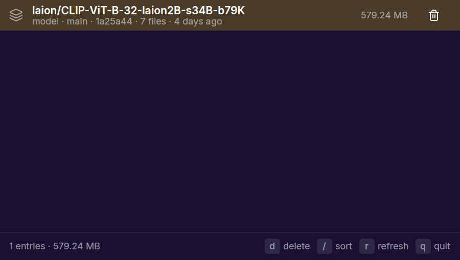
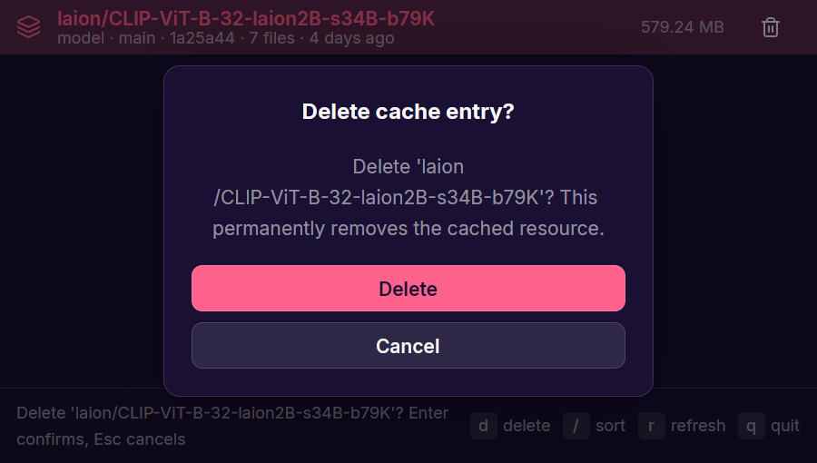

# hf-cache

A desktop GUI application for browsing and managing the Hugging Face cache, built with [GPUIX](https://github.com/antibonzola/gpuix) (a Rust GPU-accelerated React renderer) using the Adwaita (GTK4/libadwaita) nightsky theme.



  

## Usage

### Run from repository

```bash
nix run github:knoopx/hf-cache
```

### Add to your flake.nix manually

```nix
{
  inputs.hf-cache.url = "github:knoopx/hf-cache";
  outputs = { self, nixpkgs, hf-cache, ... }:
    {
      apps.x86_64-linux.default = hf-cache.apps.x86_64-linux.default;
    };
}
```

## Develop

```bash
bun install
bun run dev        # hot reload
bun run typecheck  # tsc --noEmit
bun run build      # bun build --compile -> dist/hf-cache standalone binary
```
